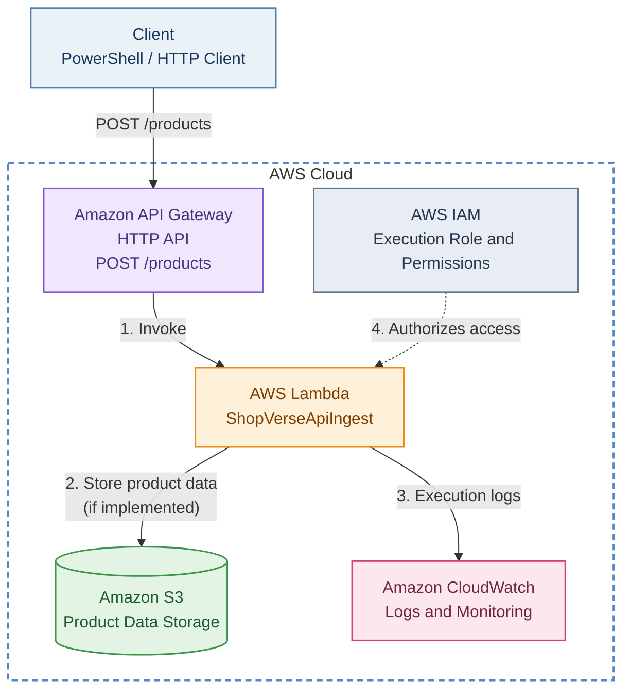

# ShopVerse — AWS Lambda Capstone Project

**A Serverless Application Using AWS Lambda, API Gateway, Amazon S3, and CloudWatch**

This project demonstrates the implementation of a serverless application using AWS services. It covers API-based product ingestion, Lambda deployment, S3 integration, IAM permissions, API testing, and application monitoring.

---

## Table of Contents

- [1. Project Overview](#1-project-overview)
- [2. Architecture Diagram](#2-architecture-diagram)
- [3. Technologies Used](#3-technologies-used)
- [4. Project Structure](#4-project-structure)
- [5. Prerequisites](#5-prerequisites)
- [6. Implementation Steps](#6-implementation-steps)
- [7. API Testing](#7-api-testing)
- [8. Verification Checklist](#8-verification-checklist)
- [9. Troubleshooting](#9-troubleshooting)
- [10. GitHub Deployment](#10-github-deployment)
- [11. Cleanup](#11-cleanup)

---

## 1. Project Overview

The objective of this project is to build and test serverless components for a sample e-commerce application named **ShopVerse**.

### Project objectives

- Develop a Python-based AWS Lambda function.
- Package application code and dependencies for deployment.
- Expose the application through Amazon API Gateway.
- Configure a `POST /products` API route.
- Integrate Lambda with Amazon S3 where required.
- Configure IAM execution-role permissions.
- Test the API using Windows PowerShell.
- Monitor application execution through Amazon CloudWatch Logs.
- Document deployment steps, commands, and validation results.

### Expected outcome

A working API endpoint that accepts product information, invokes the Lambda function, validates the request, and processes the product according to the application logic.

---

## 2. Architecture Diagram

The following architecture diagram uses Mermaid syntax and renders directly on GitHub. Its layout follows a draw.io-style architecture with clearly labeled services, directional arrows, and an AWS Cloud boundary.



### Architecture workflow

| Step | Component | Description |
|---|---|---|
| 1 | Client | Sends a product request using HTTP POST. |
| 2 | API Gateway | Routes the request to the Lambda integration. |
| 3 | AWS Lambda | Validates and processes the incoming request. |
| 4 | Amazon S3 | Stores product data if the application implements S3 writes. |
| 5 | CloudWatch | Captures execution logs for troubleshooting. |
| 6 | AWS IAM | Grants the execution permissions required by Lambda. |

**Architecture notes**

- CloudWatch logging requires the appropriate Lambda execution-role permissions.
- S3 access must be explicitly authorized for the intended bucket and operations.
- API Gateway requires permission to invoke the Lambda function.
- The S3 connection represents the intended integration and must be verified against the actual `app.py` implementation.

### Create an editable draw.io diagram

To create a native draw.io file matching this architecture:

1. Open [diagrams.net](https://app.diagrams.net/).
2. Create a blank diagram.
3. Add an AWS Cloud boundary.
4. Add AWS API Gateway, Lambda, S3, CloudWatch, and IAM shapes.
5. Connect the components with directional arrows.
6. Label the API route as `POST /products`.
7. Save the file as `shopverse-architecture.drawio`.

To display an exported draw.io image inside this README, export the diagram as PNG and place it in your repository at:

```text
docs/architecture.png
```

Then add this Markdown immediately below the Mermaid diagram if you want to display the exported draw.io version instead:

```markdown

```

Commit both the image and the README to GitHub. The Markdown image will only render after the referenced image exists in your repository.

---

## 3. Technologies Used

| Technology | Purpose |
|---|---|
| AWS Lambda | Executes serverless Python code |
| Amazon API Gateway | Exposes an HTTP endpoint |
| Amazon S3 | Stores objects and product data |
| AWS IAM | Manages resource permissions |
| Amazon CloudWatch | Provides logs and monitoring |
| Python | Implements application logic |
| AWS CLI | Manages and deploys AWS resources |
| PowerShell | Executes AWS and API testing commands |
| Visual Studio Code | Development environment |
| Git and GitHub | Source control and documentation |

---

## 4. Project Structure

Recommended repository structure:

```text
lamdacapstone/
│
├── lambda_api_ingest/
│   ├── app.py
│   └── requirements.txt
│
├── docs/
│   └── architecture.png
│
├── README.md
└── .gitignore
```

The `docs/architecture.png` file is optional if you use only the Mermaid diagram.

If you create a native draw.io diagram, you can also add:

```text
docs/
├── architecture.png
└── shopverse-architecture.drawio
```

Only include files that actually exist in your project.

---

## 5. Prerequisites

Before starting, ensure that the following are available:

- An AWS account with the necessary permissions.
- AWS CLI installed and configured.
- Python installed.
- Git installed.
- Visual Studio Code.
- An IAM role for Lambda execution.
- An available S3 bucket if S3 storage is required.

### Step 1: Configure AWS CLI

Open the VS Code PowerShell terminal and execute:

```powershell
aws configure
```

Enter the requested AWS credentials and region.

Verify the AWS identity:

```powershell
aws sts get-caller-identity
```

Check the configured region:

```powershell
aws configure get region
```

The deployment commands below assume the `us-east-1` region. Use the region where your resources actually exist.

> Never commit AWS access keys, secret keys, session tokens, or other credentials to GitHub.

---

## 6. Implementation Steps

### Step 1: Navigate to the project directory

Replace the path with your actual local project location.

```powershell
cd "C:\path\to\lamdacapstone"
```

Create the Lambda application directory if it does not exist:

```powershell
New-Item -ItemType Directory -Force -Path lambda_api_ingest
```

Navigate into it:

```powershell
cd lambda_api_ingest
```

### Step 2: Prepare the application files

Create these files:

- `app.py` — contains the Lambda handler and application logic.
- `requirements.txt` — lists the Python dependencies, if any.

Example `requirements.txt`:

```text
# Add application-specific third-party dependencies here.
```

The example is intentionally empty because the exact dependencies depend on the implementation in `app.py`. Boto3 is available in the standard Lambda Python runtime, although packaging a specific version may be appropriate when required.

Ensure that your handler function is named `lambda_handler` if you use the handler setting `app.lambda_handler`.

### Step 3: Package the Lambda application

Run these commands from the `lambda_api_ingest` directory.

Create a package directory:

```powershell
New-Item -ItemType Directory -Force -Path package
```

Install dependencies, if listed:

```powershell
python -m pip install -r requirements.txt -t .\package
```

Copy the application code:

```powershell
Copy-Item .\app.py .\package\app.py -Force
```

Create the ZIP archive:

```powershell
Compress-Archive `
    -Path .\package\* `
    -DestinationPath .\lambda_api_ingest.zip `
    -Force
```

Verify the archive:

```powershell
Get-Item .\lambda_api_ingest.zip
```

The ZIP must contain `app.py` at its root, not inside an extra nested `package` directory.

If your application has additional source files, include them in the deployment package as well.

### Step 4: Identify the AWS account and execution role

Return to the project root:

```powershell
cd ..
```

Retrieve the AWS account ID:

```powershell
$accountId = (aws sts get-caller-identity --query Account --output text).Trim()
```

Display it:

```powershell
$accountId
```

Check whether the lab execution role exists:

```powershell
aws iam get-role --role-name lambda-basic-exec
```

If this role does not exist, use the role supplied by your training environment or create an appropriate role if your account permissions allow it.

### Step 5: Deploy the Lambda function

Navigate back to the application directory:

```powershell
cd lambda_api_ingest
```

Set the role ARN:

```powershell
$roleArn = "arn:aws:iam::$accountId`:role/lambda-basic-exec"
```

Create the Lambda function if it does not already exist:

```powershell
aws lambda create-function `
    --function-name ShopVerseApiIngest `
    --runtime python3.11 `
    --role $roleArn `
    --handler app.lambda_handler `
    --zip-file fileb://lambda_api_ingest.zip `
    --timeout 30 `
    --memory-size 256
```

If the function already exists, update its code instead:

```powershell
aws lambda update-function-code `
    --function-name ShopVerseApiIngest `
    --zip-file fileb://lambda_api_ingest.zip
```

Check the deployment status:

```powershell
aws lambda get-function-configuration `
    --function-name ShopVerseApiIngest
```

Wait for an update to finish before invoking the function.

**Note:** Use the Python runtime supported by your AWS account and application. If the training account does not allow the selected runtime or role, resolve that configuration issue before continuing.

### Step 6: Configure Amazon S3

List available buckets:

```powershell
aws s3 ls
```

Set your existing bucket name:

```powershell
$bucket = "YOUR_EXISTING_BUCKET_NAME"
```

Verify that the bucket is accessible:

```powershell
aws s3 ls "s3://$bucket/"
```

If the lab requires a new bucket, create one only if the name is globally available and your account has permission.

For a new bucket in `us-east-1`:

```powershell
aws s3api create-bucket `
    --bucket "YOUR_UNIQUE_BUCKET_NAME" `
    --region us-east-1
```

Replace the placeholder with the bucket name you intend to use.

**Permissions required:** If Lambda writes product data to S3, the Lambda execution role must allow the required operation, such as `s3:PutObject`, on the intended bucket.

The application must also contain the corresponding S3 upload logic. Creating a bucket alone does not connect it to Lambda.

### Step 7: Configure Amazon API Gateway

In the AWS Management Console:

1. Open **Amazon API Gateway**.
2. Create an HTTP API or open the existing API.
3. Add a Lambda integration for `ShopVerseApiIngest`.
4. Create the `POST /products` route.
5. Associate the route with the Lambda integration.
6. Deploy the API to the appropriate stage.
7. Copy the invoke URL.
8. Confirm that API Gateway has permission to invoke the Lambda function.

The endpoint typically follows this format:

```text
https://<API_ID>.execute-api.us-east-1.amazonaws.com/products
```

Use the actual invoke URL shown in your API Gateway console. If your API uses a named stage, include that stage in the URL as appropriate.

### Step 8: Verify the API configuration

Set the endpoint in PowerShell:

```powershell
$apiEndpoint = "YOUR_EXISTING_API_ENDPOINT"
```

Display the value:

```powershell
$apiEndpoint
```

Confirm that the endpoint contains the correct API ID, region, stage if applicable, and `/products` route.

### Step 9: Test Lambda directly

Create a test payload matching your handler's required fields.

Example, if the application expects a `name` field:

```powershell
'{"name":"Test Product"}' |
    Set-Content -Path .\test-event.json -Encoding ascii
```

Invoke the function:

```powershell
aws lambda invoke `
    --function-name ShopVerseApiIngest `
    --payload fileb://test-event.json `
    .\lambda-response.json
```

Read the response:

```powershell
Get-Content .\lambda-response.json
```

A successful Lambda invocation does not automatically mean the business logic succeeded. Inspect both the invocation metadata and the response payload.

If the handler expects API Gateway's event structure, use a test event that matches that structure.

### Step 10: Test the API using PowerShell

Return to your project root or another convenient working directory.

Set the API endpoint:

```powershell
$apiEndpoint = "YOUR_EXISTING_API_ENDPOINT"
```

Prepare a request body:

```powershell
$body = @{
    name = "Test Product"
} | ConvertTo-Json -Compress
```

Send the request:

```powershell
Invoke-RestMethod `
    -Uri $apiEndpoint `
    -Method POST `
    -ContentType "application/json" `
    -Body $body
```

Inspect the returned response.

If the application requires additional fields, include them in `$body`. For example, add a product ID or price only if the application expects those fields.

### Step 11: Verify CloudWatch Logs

Open **Amazon CloudWatch → Logs → Log groups**.

Look for the Lambda log group:

```text
/aws/lambda/ShopVerseApiIngest
```

Open the latest log stream and check the function execution details.

Alternatively, run:

```powershell
aws logs describe-log-groups `
    --log-group-name-prefix "/aws/lambda/ShopVerseApiIngest"
```

Confirm that the function has the required CloudWatch Logs permissions.

---

## 7. API Testing

Use the following cases to validate the implementation.

| Test case | Expected validation |
|---|---|
| Valid product request | Application processes the request successfully |
| Missing required `name` | Application returns a validation error |
| Invalid JSON | Request is rejected or handled as an application error |
| Incorrect endpoint | API Gateway returns a route or resource error |
| Lambda execution failure | Error appears in the response or execution logs |
| Valid S3 write | Product object is stored when S3 upload logic is implemented |

Actual HTTP status codes and response messages depend on the handler's implementation and API Gateway configuration.

### Example: Verify an S3 object

If your application returns or uses a known object key, check the bucket:

```powershell
aws s3 ls "s3://$bucket/"
```

If the application stores objects in a prefix, specify it:

```powershell
aws s3 ls "s3://$bucket/products/"
```

Use the actual object key or prefix from your application. An empty bucket does not necessarily mean the API failed if the application does not write to S3.

---

## 8. Verification Checklist

Use this checklist before submitting the assignment.

### AWS configuration

- [ ] AWS CLI configured and identity verified.
- [ ] Correct AWS region selected.
- [ ] Lambda execution role identified.
- [ ] Lambda function created or updated.
- [ ] API Gateway HTTP API configured.
- [ ] `POST /products` route created.
- [ ] Lambda integration configured.
- [ ] API Gateway invocation permission verified.

### Application testing

- [ ] Lambda handler tested directly.
- [ ] API endpoint tested using PowerShell.
- [ ] Valid request tested.
- [ ] Missing required field tested.
- [ ] CloudWatch execution logs inspected.
- [ ] S3 storage verified if implemented.

### Documentation and submission

- [ ] README added to the repository root.
- [ ] Architecture diagram renders correctly on GitHub.
- [ ] Optional draw.io PNG committed if used.
- [ ] Optional editable `.drawio` file committed if used.
- [ ] Screenshots captured for the lab submission.
- [ ] No AWS credentials or sensitive configuration committed.

Only mark a task complete after confirming it in your AWS account.

---

## 9. Troubleshooting

### Access denied or explicit deny

Check the IAM permissions and any training-account service control policies. An explicit deny cannot be overridden by adding another allow policy.

### Lambda function already exists

Use `aws lambda update-function-code` rather than trying to create the same function again.

### Invalid execution role

Verify that the role exists, belongs to the correct AWS account, and has a trusted relationship that allows Lambda to assume it.

### API returns `name is required`

Verify that the request body contains the required field and that the Lambda handler correctly parses the incoming JSON.

### API returns an internal server error

Inspect CloudWatch Logs, API Gateway integration settings, and Lambda invocation permissions.

### Python module not found

Check that the dependency is installed into the deployment package and that the ZIP archive contains the expected files at the correct directory level.

### API Gateway route is unavailable

Check that the HTTP API route exists, the integration is attached, and the API has been deployed to the correct stage.

### Git rejects the push

Review `.gitignore` and remove large generated files or sensitive credentials from the staged changes. If a large file has already been committed, simply adding it to `.gitignore` may not remove it from Git history.

---

## 10. GitHub Deployment

### Step 1: Create or update README.md

Ensure that `README.md` is located in the repository root:

```text
lamdacapstone/
└── README.md
```

Paste this documentation into the file and save it in Visual Studio Code.

### Step 2: Review Git status

From the repository root, run:

```powershell
git status
```

Confirm that you are in the correct repository.

### Step 3: Stage the documentation

```powershell
git add README.md
```

If you also created the diagram files:

```powershell
git add docs/
```

### Step 4: Commit the changes

```powershell
git commit -m "Improve ShopVerse project documentation"
```

### Step 5: Push to GitHub

For the `main` branch:

```powershell
git push origin main
```

If your branch is named `master`, use:

```powershell
git push origin master
```

If the GitHub remote has not been configured, inspect it first:

```powershell
git remote -v
```

Add the remote only if needed:

```powershell
git remote add origin https://github.com/Chandhini2/lamdacapstone.git
```

Verify the branch:

```powershell
git branch --show-current
```

Then push the appropriate branch.

### Step 6: Verify the rendered README

Open your repository on GitHub and confirm that:

- The headings and table of contents display correctly.
- The Mermaid architecture diagram renders.
- Code blocks are properly formatted.
- Tables are readable.
- Any referenced architecture images load correctly.

---

## 11. Cleanup

Delete resources only after completing the lab, collecting the required screenshots, and confirming that they are no longer needed.

To delete the Lambda function:

```powershell
aws lambda delete-function `
    --function-name ShopVerseApiIngest
```

Delete an API Gateway API only if it was created specifically for this project and is no longer required.

Delete an S3 bucket only if you own it and have confirmed that its contents are no longer needed. Empty the bucket first if required.

**Cost reminder:** AWS resource charges depend on service usage, account terms, and applicable free-tier eligibility.

---

## Project Summary

This project demonstrates key serverless cloud concepts using AWS Lambda, API Gateway, Amazon S3, IAM, and CloudWatch.

It provides a practical reference for:

- Serverless application deployment.
- HTTP API integration.
- Python packaging for AWS Lambda.
- IAM permissions and cloud resource access.
- API validation and troubleshooting.
- CloudWatch logging and monitoring.
- Technical documentation and GitHub version control.

**Project:** ShopVerse — AWS Lambda Capstone  
**Repository:** `lamdacapstone`  
**Primary Lambda Function:** `ShopVerseApiIngest`  
**Primary API Route:** `POST /products`
